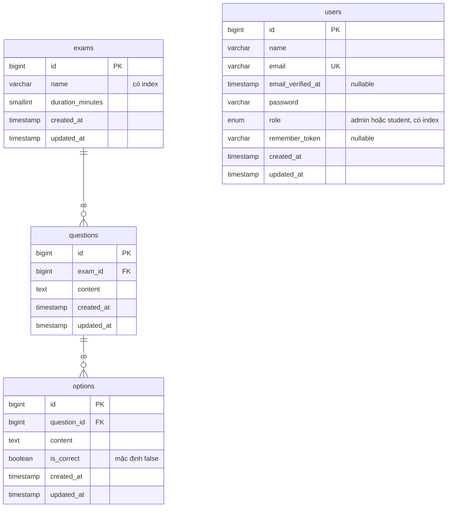

# Hệ thống thi trắc nghiệm

Bài test Laravel 11 dùng MySQL 8 và MongoDB 7, chạy bằng Docker.

**Trạng thái hiện tại:** đã xong task 1–20, gồm cả bonus (task 19) và task nâng cao 20 (autosave). Không làm task 21–22 vì đề chỉ yêu cầu 1 trong 3 task nâng cao. Chi tiết ở mục [Những gì chưa làm được và vì sao](#những-gì-chưa-làm-được-và-vì-sao).

## Chạy dự án

Chỉ cần Docker Desktop (hoặc Docker Engine có Compose v2) và các cổng `8000`, `3306`, `27018` đang trống. Không cần cài PHP, Composer, Node, MySQL hay MongoDB trên máy.

```bash
git clone https://github.com/TQanh23/test_intern.git
cd test_intern
docker compose up -d
```

Mở <http://localhost:8000>. Lần đầu sẽ lâu hơn vì phải tải image và dependency, lệnh `up -d` chỉ xong khi app đã sẵn sàng.

Mỗi lần khởi động, container `app` tự chạy [docker/php/entrypoint.sh](docker/php/entrypoint.sh): tạo `.env` nếu chưa có, chạy `composer install`, tạo `APP_KEY` nếu còn trống, rồi chạy migration. Seed chỉ chạy khi database còn trống.

Sau khi sửa `docker/php/`, chạy `docker compose up -d --build` để build lại image.

Nếu trùng cổng, sửa phần `ports` trong `docker-compose.yml`. App không bị ảnh hưởng vì các container gọi nhau qua cổng nội bộ.

### Dữ liệu mẫu

| Vai trò | Email | Mật khẩu |
|---|---|---|
| Admin | `admin@example.com` | `password` |
| Student | `student@example.com` | `password` |

Seeder cũng tạo 2 đề: "Toán cơ bản" (15 phút, 5 câu) và "Tiếng Anh cơ bản" (10 phút, 4 câu), mỗi câu có 4 đáp án. Câu hỏi viết tay để biết trước đáp án đúng khi kiểm tra điểm. Các tài khoản này chỉ dùng cho dev và demo.

Đăng nhập tại <http://localhost:8000/login>. Trang quản trị ở `/admin`, chỉ tài khoản admin mở được.

## Lệnh thường dùng

| Việc cần làm | Lệnh |
|---|---|
| Chạy test (cần container `mongo` đang chạy) | `docker compose exec app php artisan test` |
| Kiểm tra định dạng code | `docker compose exec app ./vendor/bin/pint --test` |
| Kiểm tra kết nối MySQL và MongoDB | `docker compose exec app php artisan app:check-connections` |
| Chấm ngay các bài hết giờ bị bỏ dở (container `scheduler` cũng tự chạy mỗi phút) | `docker compose exec app php artisan app:close-expired-attempts` |
| Chạy lệnh artisan | `docker compose exec app php artisan <lệnh>` |
| Cài package PHP | `docker compose exec app composer require <package>` |
| Chạy Vite (cần Node trên máy) | `npm install && npm run dev` |
| Build lại frontend | `docker compose run --rm assets` |
| Tắt stack, giữ dữ liệu | `docker compose down` |
| Tắt stack, xóa cả dữ liệu | `docker compose down -v` |

Kết nối từ công cụ trên máy:

| Dịch vụ | Địa chỉ | Tài khoản |
|---|---|---|
| MySQL | `127.0.0.1:3306`, database `exam` | `exam` / `secret` |
| MongoDB | `mongodb://127.0.0.1:27018`, database `exam` | không có |

Các thông tin trên chỉ dùng cho môi trường dev.

## Quyết định kỹ thuật

### Dữ liệu nào để MySQL, dữ liệu nào để MongoDB

Schema MySQL đã có migration. Hai collection MongoDB đã có Model và index. `attempts` được ghi khi làm bài, `activity_logs` được ghi qua Event/Observer.

| Nơi lưu | Dữ liệu | Lý do |
|---|---|---|
| MySQL | `users`, `exams`, `questions`, `options` | Dữ liệu có quan hệ chặt, được admin sửa thường xuyên, cần foreign key và ràng buộc unique. |
| MySQL | `personal_access_tokens` | Token API của Sanctum, gắn với `users`. |
| MongoDB | `attempts` | Mỗi lượt làm bài là một document chứa snapshot câu hỏi, câu trả lời và điểm. Đọc kết quả không cần join. |
| MongoDB | `activity_logs` | Dữ liệu chỉ ghi thêm, số lượng lớn, mỗi hành động có thể có trường khác nhau. |

- **Vì sao `attempts` cần snapshot:** nếu admin sửa hoặc xóa câu hỏi sau khi thi, bài đã nộp vẫn phải giữ nguyên nội dung và điểm.
- **Thống kê:** điểm trung bình, top học sinh và câu sai nhiều đều nằm trong `attempts`, nên dùng aggregation của MongoDB.
- **Đánh đổi:** MongoDB không có foreign key tới MySQL. `user_id` và `exam_id` trong `attempts` phải do code ứng dụng giữ đúng.

### ERD MySQL



- **Xóa theo:** xóa một đề sẽ xóa các câu hỏi của đề đó, xóa một câu hỏi sẽ xóa các đáp án của câu đó (`ON DELETE CASCADE`).
- **`users` đứng riêng:** không có khóa ngoại tới bảng đề thi, vì lượt làm bài nối học sinh với đề nằm ở `attempts` trong MongoDB.
- **Không vẽ các bảng hạ tầng của Laravel:** `password_reset_tokens`, `sessions`, `cache`, `cache_locks`, `jobs`, `job_batches`, `failed_jobs`.

### Collection MongoDB

Cả hai collection đều có index trên `user_id`, `exam_id` và `created_at`. `attempts` có thêm unique index một phần `one_open_attempt_per_exam`, xem mục [Autosave và tiếp tục bài](#autosave-và-tiếp-tục-bài). Index được tạo bằng migration, dùng `table()` thay vì `create()` vì `migrate:fresh` không xóa collection.

`attempts`:

| Trường | Kiểu | Ghi chú |
|---|---|---|
| `user_id`, `exam_id` | int | Trùng id bên MySQL |
| `exam_name`, `duration_minutes` | string, int | Snapshot, xóa đề vẫn còn |
| `status` | string | `in_progress` hoặc `submitted` |
| `started_at`, `deadline_at`, `submitted_at` | date | `submitted_at` để trống khi đang làm |
| `score`, `total` | int | Số câu đúng và tổng số câu, để trống đến khi chấm |
| `questions` | mảng | Snapshot câu hỏi: `question_id`, `content`, `options` (`option_id`, `content`, `is_correct`), `selected_option_id`, `is_correct` |
| `created_at`, `updated_at` | date | |

`activity_logs`:

| Trường | Kiểu | Ghi chú |
|---|---|---|
| `user_id` | int | Để trống khi chưa đăng nhập |
| `action` | string | Ví dụ `attempt.submitted` |
| `exam_id` | int | Để trống khi hành động không gắn với đề |
| `details` | object | Thông tin thêm, tùy hành động |
| `created_at` | date | Không có `updated_at` vì log chỉ ghi thêm |

- **`questions` không cast sang `array`:** cần giữ mảng thật trong MongoDB để `$unwind` ở phần thống kê hoạt động.
- **`score` là số câu đúng:** các đề có số câu khác nhau, nên xếp hạng giữa các đề phải tính theo `score / total`.
- **Cấu trúc document không được database ép buộc:** phần tạo và chấm attempt phải ghi đúng cấu trúc trên.

### Môi trường Docker

- **PHP và Composer nằm trong container:** tránh phải cài extension `mongodb` trên từng máy.
- **Entrypoint tự chuẩn bị app:** chỉ cần `docker compose up`. Nginx chờ healthcheck của `app` nên không trả lỗi 502 trong lúc cài dependency.
- **Service `assets` build frontend mỗi lần khởi động:** trang dùng `@vite`, mà `public/build` là file sinh ra nên không commit vào git. Thiếu bước này thì clone mới sẽ lỗi 500 ở `/login`. Đổi lại, mỗi lần khởi động lâu hơn một chút. `node_modules` nằm trong named volume cùng lý do với `vendor`.
- **`vendor` nằm trong named volume, không bind mount:** trên Windows, bind mount khiến mỗi lệnh `artisan` mất khoảng 14 giây, dùng volume còn khoảng 0,4 giây. Đổi lại, `vendor` trên máy không tự cập nhật, nên IDE có thể chưa gợi ý code của package mới.
- **Service `scheduler` chạy `php artisan schedule:work`:** gọi các lệnh định kỳ khai báo trong `routes/console.php`. Hiện chỉ có lệnh chấm bài bỏ dở, chạy mỗi phút. Service dùng chung image, code và `vendor` với `app`, và chỉ khởi động sau khi `app` healthy. Entrypoint chỉ cài dependency và migrate khi lệnh là `php-fpm`, nên container này không chạy lại các bước đó. Xem log bằng `docker compose logs scheduler`.
- **MongoDB mở ra máy qua cổng `27018`:** tránh trùng với MongoDB cài sẵn trên máy, thường chiếm `27017`.
- **MySQL và MongoDB chỉ bind vào `127.0.0.1`:** MongoDB không đặt mật khẩu nên không được mở ra mạng ngoài.

### CI

GitHub Actions chạy [.github/workflows/ci.yml](.github/workflows/ci.yml) cho mỗi PR và mỗi lần push lên `main`.

- **Dùng lại Docker Compose, không cài PHP riêng trên runner:** `docker compose up -d` chạy đúng luồng của người dùng thật, nên kiểm tra luôn việc cài dependency, build frontend, migrate và seed trên MySQL. Không phải khai báo lại phiên bản PHP, extension và service ở hai nơi. Đổi lại mỗi lần chạy lâu hơn vì phải build image.
- **Các bước kiểm tra:** Pint, toàn bộ test, rồi mở `/login` bằng `curl`. Test gọi `withoutVite()` nên bước `curl` mới phát hiện được lỗi 500 khi thiếu `public/build`.

### Xác thực và phân quyền

- **Breeze + Blade:** có sẵn đăng ký, đăng nhập và giới hạn số lần đăng nhập sai, đi kèm Alpine.js. PHP render trang nên dễ theo dõi hơn SPA.
- **Sanctum chưa cài:** chỉ cần cho API, sẽ thêm khi làm API REST.
- **Middleware `admin`:** `EnsureUserIsAdmin` trả 403 nếu user không phải admin. Đề chỉ có một vùng cần chặn nên không làm dạng `role:admin` tổng quát.
- **`role` không nằm trong `$fillable`:** client gửi `role=admin` khi đăng ký vẫn chỉ tạo được student, có test kiểm tra.

### Quản lý đề thi

- **Mỗi câu có đúng 4 đáp án, chọn đáp án đúng bằng radio:** form đơn giản và luôn có đúng 1 đáp án đúng. Đổi lại không tạo được câu chỉ có 2 đáp án.
- **Sửa câu hỏi thì xóa đáp án cũ rồi tạo lại trong transaction:** không phải đối chiếu từng đáp án. `option_id` thay đổi nhưng không ảnh hưởng bài đã làm, vì `attempts` chấm theo snapshot.
- **Tìm bằng `LIKE '%từ khóa%'`:** tìm được ở giữa tên nhưng không dùng được index `name`, chấp nhận được vì số đề ít.
- **View phân trang nằm trong `resources/views/vendor/pagination`:** service `assets` không thấy `vendor/` của app, nên Tailwind chỉ quét được bản nằm trong `resources`.

### Bắt đầu làm bài

- **Tạo attempt bằng POST rồi chuyển hướng sang GET:** tải lại trang không tạo thêm attempt.
- **Bấm bắt đầu khi đang có bài mở thì quay về bài đó:** mỗi lần làm vẫn có attempt riêng, nhưng chỉ được tạo bài mới sau khi bài cũ đã nộp hoặc hết giờ. Chi tiết ở mục [Autosave và tiếp tục bài](#autosave-và-tiếp-tục-bài).
- **Admin không làm bài được:** middleware `student` trả 403, để điểm của admin không lọt vào thống kê.
- **Quyền xem attempt nằm ở `AttemptPolicy`:** chỉ chủ attempt mở được, phải so theo từng bản ghi nên middleware không đủ.
- **`deadline_at` do server tính khi bắt đầu:** client không gửi lên, và snapshot có `is_correct` nhưng view không in ra.
- **Chỉ trộn câu hỏi:** đề không yêu cầu trộn đáp án.

### Nộp bài và chấm điểm

- **Nộp quá giờ thì chấm theo các đáp án đã lưu:** đáp án gửi kèm sau hạn bị bỏ qua, vì nhận chúng là cho thêm giờ làm bài. Các câu đã autosave trước hạn vẫn được tính, nên trình duyệt tự nộp lúc hết giờ mà request đến trễ vài ms thì học sinh cũng không mất bài. Trước khi có autosave, bài nộp quá giờ bị từ chối hẳn.
- **Client chỉ gửi lựa chọn:** `score`, `is_correct`, `status` gửi lên bị bỏ qua. Đáp án phải thuộc đúng câu đó trong snapshot mới được tính.
- **Chấm theo snapshot, không đọc MySQL:** admin sửa đề sau khi học sinh bắt đầu không làm đổi điểm.
- **Ghi kết quả kèm điều kiện `status = in_progress`:** MongoDB xử lý một lần cập nhật một cách nguyên tử, nên hai request nộp cùng lúc chỉ có một request ghi được.

### Autosave và tiếp tục bài

- **Lưu từng câu ngay khi chọn:** trang làm bài gọi `PATCH /attempts/{id}/answers` bằng axios mỗi khi chọn một đáp án, rồi hiện "Đã lưu" hoặc "Chưa lưu được". Đáp án được ghi vào `selected_option_id` trong snapshot, nên tải lại trang vẫn thấy các câu đã chọn.
- **Ghi bằng một lệnh `updateOne` có điều kiện `status = in_progress` và `deadline_at >= now`:** không ghi được vào bài đã nộp hoặc đã hết giờ, kể cả khi request lưu và request nộp tới cùng lúc. Lệnh dùng `getMatchedCount()` thay cho số document đã thay đổi, vì chọn lại đúng đáp án cũ thì không có gì thay đổi nhưng vẫn là thành công.
- **Đáp án phải thuộc đúng câu trong snapshot:** giống lúc chấm, client không ghi được `option_id` tùy ý.
- **Mỗi student chỉ có 1 bài đang mở cho mỗi đề, do MongoDB chặn:** unique index một phần `one_open_attempt_per_exam` trên `(user_id, exam_id)`, chỉ áp dụng cho `status = in_progress`. Hai request "Bắt đầu" cùng lúc thì request sau gặp lỗi trùng khóa (mã 11000), và Service trả về bài mà request kia vừa tạo.
- **Bài hết giờ bị bỏ dở được chấm theo đáp án đã lưu, ở 3 chỗ:**
  - bấm "Bắt đầu" lại đề đó: bài cũ được chấm rồi mới tạo bài mới
  - bấm "Chấm bài" trên trang làm bài
  - lệnh `app:close-expired-attempts`, container `scheduler` chạy mỗi phút

  Cả 3 chỗ đều gọi `AttemptService::submit()`, nên điểm tính giống hệt lúc tự nộp và vẫn có log `attempt.submitted`. Lệnh ghi có điều kiện `status = in_progress`, nên chạy trùng lúc với học sinh tự nộp cũng không chấm hai lần. Không chấm khi chỉ mở trang, vì request GET không nên ghi dữ liệu.
- **Gửi các request lưu lần lượt:** trình duyệt chỉ gửi request lưu tiếp theo khi request trước đã xong. Nhờ vậy, khi đổi đáp án nhanh, request cũ đến muộn không ghi đè đáp án mới. Một request lỗi không chặn các request sau. Không đánh số thứ tự ở server, vì phải thêm trường vào snapshot và xử lý số thứ tự bị reset khi reload, trong khi chỉ còn sót trường hợp mở 2 tab cùng một bài.
- **Đồng hồ đếm ngược từ số giây còn lại do server tính:** mỗi lần tải trang, server tính lại `deadline_at - now`, nên reload không reset đồng hồ và giờ máy client sai cũng không ảnh hưởng. JS tính theo mốc kết thúc mỗi giây, nên tab chạy nền bị chậm cũng không lệch. Về 0 thì form tự nộp.
- **Không ghi activity log cho từng câu:** sẽ sinh quá nhiều log. `attempt.started` và `attempt.submitted` đã đủ.

### Trang kết quả

- **Dùng lại trang `attempts.show`, không thêm route riêng:** route, policy và redirect sau khi nộp đã có sẵn, trang chỉ đổi nội dung theo `status`.
- **Đọc từ snapshot, không đọc MySQL:** kết quả giữ nguyên khi admin sửa hoặc xóa đề, và không phát sinh query theo từng câu.
- **Chỉ hiện đáp án khi `status = submitted`:** bài hết giờ mà chưa chấm thì trang chỉ có nút "Chấm bài", bấm vào sẽ chấm theo các đáp án đã lưu.

### Activity log

Không controller nào ghi log. Mọi log đi qua [RecordActivity](app/Listeners/RecordActivity.php) hoặc [ExamObserver](app/Observers/ExamObserver.php).

| `action` | Nguồn | `details` |
|---|---|---|
| `auth.login`, `auth.logout` | Event `Login`, `Logout` có sẵn của Laravel | |
| `attempt.started` | Event `AttemptStarted`, phát trong `AttemptService::start()` | `attempt_id` |
| `attempt.submitted` | Event `AttemptSubmitted`, phát trong `AttemptService::submit()` | `attempt_id`, `score`, `total` |
| `exam.created`, `exam.updated`, `exam.deleted` | `ExamObserver` | `name`, riêng `updated` có thêm `changes` |

- **Bài làm dùng Event, không dùng Observer trên `Attempt`:** lúc nộp bài, code cập nhật bằng query có điều kiện `status = in_progress` để chống nộp hai lần. Lệnh update kiểu này không phát model event, nên Observer không bắt được.
- **Đề thi dùng Observer:** admin controller gọi thẳng `Exam::create`, `update`, `delete`, nên model event tự phát mà không phải sửa controller.
- **Event phát trong Service:** API nộp bài sau này gọi lại `AttemptService` nên tự có log.
- **Listener chạy đồng bộ:** dự án chưa có queue worker. Thêm worker chỉ để ghi log thì phức tạp hơn mức cần.
- **Không ghi `Registered`:** đăng ký xong Laravel tự đăng nhập luôn, nên đã có log `auth.login`.
- **Chưa ghi thao tác với câu hỏi:** chỉ ghi ở cấp đề thi. Muốn ghi thì thêm `QuestionObserver` theo cùng cách.

### Thống kê

Trang `/admin/statistics`. Ba số liệu do [StatisticsService](app/Services/StatisticsService.php) tính bằng aggregation trên `attempts`, chỉ lấy bài có `status = submitted`.

| Số liệu | Cách tính |
|---|---|
| Tỷ lệ đúng trung bình theo đề | `$group` theo `exam_id`, lấy trung bình `score / total` |
| Top 10 học sinh | `$group` theo `user_id`, lấy trung bình `score / total`. Bằng nhau thì ai nộp nhiều bài hơn xếp trước. Tên học sinh lấy từ MySQL bằng một query `whereIn` |
| 10 câu sai nhiều nhất | `$unwind` mảng `questions`, `$group` theo `question_id`, đếm số lần `is_correct = false` |

- **Tính theo tỷ lệ, không theo số câu đúng:** các đề có số câu khác nhau. Admin cũng có thể thêm câu sau khi đã có bài nộp, nên các bài của cùng một đề cũng có thể có `total` khác nhau.
- **Câu bỏ trống tính là sai:** giống quy tắc lúc chấm điểm.
- **Tên đề và nội dung câu lấy từ snapshot của bài nộp gần nhất:** đề đã xóa hoặc đổi tên vẫn hiển thị được, không phải query MySQL theo từng dòng.
- **Gọi thẳng collection, không dùng `Attempt::raw()`:** `raw()` biến mỗi dòng kết quả thành model `Attempt`. Gọi collection thì nhận về mảng thường.
- **Xếp theo tỷ lệ trung bình có nhược điểm:** học sinh chỉ làm một bài đạt 100% vẫn đứng đầu.

### API

Xác thực bằng token Sanctum, gửi trong header `Authorization: Bearer <token>`. Chỉ tài khoản student gọi được, giống phần làm bài trên web.

| Method | URL | Thành công | Lỗi |
|---|---|---|---|
| GET | `/api/exams` | 200: `data` (`id`, `name`, `duration_minutes`, `questions_count`), `links`, `meta`; 10 đề mỗi trang | 401, 403 |
| POST | `/api/attempts/{id}/submit` | 200: `data` gồm điểm, `status`, giờ bắt đầu, hạn nộp, giờ nộp và `questions` đã chấm | 401; 403 nếu không phải bài của mình; 404; 422 nếu `answers` sai định dạng hoặc bài đã nộp. Nộp quá giờ vẫn trả 200, chấm theo các đáp án đã lưu |

Body khi nộp bài giống form web: `{"answers": {"<question_id>": <option_id>}}`. Câu bỏ trống thì không gửi. Lỗi theo format mặc định của Laravel: luôn có `message`, riêng 422 có thêm `errors`.

Chưa có endpoint đăng nhập hay bắt đầu bài. Để thử bằng tay:

```bash
# 1. Tạo token cho tài khoản student mẫu
docker compose exec app php artisan tinker --execute="echo App\Models\User::where('email','student@example.com')->first()->createToken('manual')->plainTextToken;"

# 2. Lấy danh sách đề
curl -H "Authorization: Bearer <token>" http://localhost:8000/api/exams

# 3. Bắt đầu một bài trên web, lấy id trên URL /attempts/<id>, rồi nộp
curl -X POST -H "Authorization: Bearer <token>" -H "Content-Type: application/json" -d "{\"answers\":{}}" http://localhost:8000/api/attempts/<id>/submit
```

- **Dùng lại Service, FormRequest, Policy và middleware của web:** API chỉ thêm controller và Resource. Logic chấm điểm chỉ có một chỗ, nên web và API luôn cho cùng một kết quả, và nộp qua API cũng có activity log.
- **Lỗi ở `/api/*` luôn trả JSON:** khai báo trong `bootstrap/app.php`. Nếu không, client không gửi `Accept: application/json` sẽ bị redirect về `/login` thay vì nhận 401.
- **`AttemptResource` chỉ trả `questions` khi bài đã nộp:** snapshot chứa đáp án đúng. Sau này có thêm endpoint xem bài đang làm thì đáp án cũng không bị lộ.
- **Token Sanctum không hết hạn:** giữ mặc định của Sanctum (`expiration = null`). Thu hồi bằng cách xóa dòng tương ứng trong `personal_access_tokens`.

#### Postman collection

File [docs/postman/exam-api.postman_collection.json](docs/postman/exam-api.postman_collection.json) có 4 request: lấy danh sách đề, lấy danh sách khi không có token (401), nộp bài (200), nộp lại (422). Mỗi request có test kiểm tra status code và format JSON.

- **Dùng trong Postman:** Import file, điền biến `token` và `attempt_id` của collection (cách lấy như các bước ở trên), rồi chạy lần lượt từ trên xuống.
- **Chạy tự động bằng newman,** không cần cài gì trên máy:

```bash
docker run --rm --network test_intern_default -v "$PWD/docs/postman:/etc/newman" postman/newman:6-alpine run exam-api.postman_collection.json --env-var base_url=http://nginx --env-var token=<token> --env-var attempt_id=<id>
```

Request nộp bài sẽ nộp thật attempt đó. Trên Windows Git Bash, thay `$PWD` bằng `$(pwd -W)` và đặt `MSYS_NO_PATHCONV=1` trước lệnh.

### Cache danh sách đề

`ExamService::paginateAvailable()` cache mỗi trang trong 10 phút. Web `/exams` và API `/api/exams` cùng dùng hàm này nên cùng được cache.

- **Xóa cache bằng số phiên bản:** key có dạng `exams.available.v<số phiên bản>.page.<trang>`. Khi đề hoặc câu hỏi thay đổi, [ExamListCacheObserver](app/Observers/ExamListCacheObserver.php) tăng số phiên bản, nên mọi trang cũ không còn được đọc nữa và tự hết hạn sau đó. Không xóa từng key vì không biết có bao nhiêu trang đã được cache. Cache store `database` không hỗ trợ tags, còn `Cache::flush()` thì xóa cả dữ liệu của rate limiter.
- **Observer gắn vào cả `Exam` và `Question`:** đổi tên đề, thêm câu hỏi vào đề trống, xóa câu cuối cùng đều làm danh sách thay đổi. Observer tách riêng khỏi `ExamObserver`, vì `ExamObserver` chỉ để ghi log.
- **Vẫn đặt TTL 10 phút:** nếu dữ liệu bị sửa ngoài Eloquent (sửa thẳng trong DB, hoặc xóa hàng loạt không qua model) thì danh sách cũng không sai quá 10 phút.
- **Gọi `withPath()` sau khi lấy từ cache:** paginator giữ đường dẫn lúc được tạo. Nếu trang được cache từ `/exams` thì `links` của API sẽ trỏ về web.
- **Với store `database`, một lần đọc từ cache tốn 2 query theo khóa chính trên bảng `cache`:** một lấy số phiên bản, một lấy trang. Thay cho query đếm và query `has` kèm `withCount` trên bảng đề.

### Tổ chức code

Controller chỉ nhận request, gọi Service, rồi trả view, redirect hoặc Resource.

| Việc | Nơi đặt | Ví dụ |
|---|---|---|
| Logic nghiệp vụ | `app/Services` | `AttemptService` (bắt đầu bài, autosave, chấm điểm, chấm bài bỏ dở), `ExamService` (danh sách đề có cache, tạo và sửa câu hỏi), `StatisticsService` |
| Validate | FormRequest | `ExamRequest`, `QuestionRequest`, `SubmitAttemptRequest`, `SaveAnswerRequest` |
| Response API | API Resource | `ExamResource`, `AttemptResource` |
| Phân quyền | Middleware, Policy | `admin`, `student`, `AttemptPolicy` |
| Ghi log, xóa cache | Event/Listener, Observer | `RecordActivity`, `ExamObserver`, `ExamListCacheObserver` |
| Lệnh định kỳ | Command, chỉ gọi Service | `app:close-expired-attempts` |

- **Chặn N+1 bằng `Model::preventLazyLoading()`:** khai báo trong `AppServiceProvider`. Ở dev và test, nếu một danh sách model truy cập relation chưa được eager load thì Laravel throw ngay. Vì vậy toàn bộ test cũng kiểm tra luôn việc eager loading, kể cả cho code thêm sau này. Production tắt chế độ này để một chỗ bị sót chỉ làm trang chậm hơn, không thành lỗi 500. Test `test_exam_edit_page_eager_loads_questions_and_options` sẽ fail nếu bỏ `load('questions.options')`.
- **Các chỗ eager loading:**
  - trang sửa đề: `load('questions.options')`
  - trang sửa câu hỏi: `load('options')`
  - danh sách đề: `withCount('questions')`, không đếm theo từng đề
  - thống kê: một query `whereIn` lấy tên cho cả 10 học sinh

  Trang làm bài và trang kết quả chỉ đọc snapshot trong một document MongoDB, không có relation nào.
- **`Admin\ExamController` vẫn gọi thẳng `Exam::create`, `update`, `delete`:** mỗi chỗ chỉ là một lệnh Eloquent với dữ liệu đã validate, không có logic. Bọc vào Service chỉ thêm một lớp chuyển tiếp mà không thêm hành vi. `createQuestion` và `updateQuestion` nằm trong Service vì cần transaction và tạo lại đáp án. Log và xóa cache của đề do Observer xử lý, nên controller không phải gọi thêm gì.

### Feature test

`docker compose exec app php artisan test` chạy toàn bộ test. CI cũng chạy lại mỗi lần push và mỗi pull request. Hiện có 142 test, tất cả đều pass.

| File | Kiểm tra |
|---|---|
| `Student/SubmitAttemptTest` | **Chấm điểm:** đúng hết, sai và bỏ trống, đáp án của câu khác không được tính, client gửi điểm giả, chấm theo snapshot dù admin đã sửa đề. **Nộp quá giờ:** chấm theo đáp án đã lưu, bỏ qua đáp án gửi kèm; nộp đúng lúc hết hạn vẫn được nhận. Nộp 2 lần, nộp cùng lúc, trang kết quả |
| `Student/AutosaveTest` | Lưu từng câu, đáp án không thuộc câu đó, lưu sau hạn hoặc sau khi nộp, 1 bài mở mỗi đề, 2 request bắt đầu cùng lúc, đồng hồ theo server |
| `Student/StartAttemptTest` | Tạo attempt, snapshot đầy đủ, ẩn đáp án, quyền xem |
| `CloseExpiredAttemptsTest` | Command chấm bài bỏ dở, lịch chạy mỗi phút |
| `Api/ExamApiTest`, `Api/SubmitAttemptApiTest` | Format response và status code 200, 401, 403, 404, 422 |
| `Admin/ExamManagementTest`, `Admin/QuestionManagementTest` | CRUD, tìm kiếm, phân trang, validate, eager loading |
| `Admin/StatisticsTest` | 3 số liệu thống kê với dữ liệu biết trước điểm |
| `ActivityLogTest`, `ExamListCacheTest` | Log qua Event/Observer, cache và xóa cache |
| `AdminAccessTest`, `Auth/*` | Phân quyền admin/student, các luồng đăng nhập của Breeze |
| `MongoCollectionsTest`, `ExamSchemaTest`, `DatabaseSeederTest`, `CheckConnectionsTest` | Index, schema, seed, command kiểm tra kết nối |

### Giữ Laravel 11 dù có cảnh báo bảo mật

Đề yêu cầu Laravel 11, nhưng nhánh 11.x không còn được vá nên Composer chặn cài đặt. Dự án khóa ở `^11.57` và chỉ bỏ qua đúng 5 mã cảnh báo trong `composer.json`, không tắt cơ chế chặn.

| Mã | Mức độ | Vấn đề | Cách xử lý trong dự án |
|---|---|---|---|
| `PKSA-b41t-wbzk-9q51` | Critical | Bypass xác thực ở `TokenGuard` | Không dùng auth driver `token`. |
| `PKSA-3r5d-mb8f-1qw9` | High | CRLF injection ở rule email mặc định | Dự án chạy local, mail chỉ ghi log. |
| `PKSA-mdq4-51ck-6kdq` | Chưa phân loại | Cùng lỗi CRLF ở trên | Như trên. |
| `PKSA-m5cs-t1y6-qpcs` | Medium | Nhầm đường dẫn ở Temporary Signed URL | Phải kiểm tra lại trước khi làm task 21. |
| `PKSA-d5tc-s1qs-h781` | Low | XSS ở trang debug | Chỉ bật `APP_DEBUG` ở local. |

Khi triển khai thật cần nâng lên Laravel 12.69+ hoặc 13.30+.

## Những gì chưa làm được và vì sao

Mọi task bắt buộc đều đã xong. Cột "Còn thiếu" ghi những phần có thể làm thêm nhưng đề không yêu cầu.

| Task | Nội dung | Trạng thái | Còn thiếu |
|---|---|---|---|
| 1 | Khởi tạo Laravel 11 | Xong | |
| 2 | Docker hóa | Xong | |
| 3 | Kết nối MySQL | Xong | |
| 4 | Kết nối MongoDB | Xong | |
| 5 | `app:check-connections` | Xong | |
| 6 | README | Xong | |
| 7 | Schema MySQL | Xong | |
| 8 | Collection MongoDB | Xong | |
| 9 | Đăng ký, đăng nhập, phân quyền | Xong | Giao diện Breeze còn bằng tiếng Anh. |
| 10 | CRUD đề thi và câu hỏi | Xong | Thông báo validate còn bằng tiếng Anh. |
| 11 | Bắt đầu làm bài | Xong | |
| 12 | Nộp bài và chấm điểm | Xong | |
| 13 | Trang kết quả | Xong | Chưa có lịch sử làm bài, rời trang rồi chỉ mở lại được kết quả qua URL. |
| 14 | Thống kê admin | Xong | Chưa cache trang thống kê (task 19 chỉ cache danh sách đề), mỗi lần mở trang chạy 3 aggregation. Chưa lọc theo thời gian. |
| 15 | Activity log | Xong | Chưa có trang xem log, chỉ xem được trong MongoDB. Chưa ghi thao tác với câu hỏi. |
| 16 | API REST | Xong | Chưa có endpoint đăng nhập và bắt đầu bài, phải tạo token bằng tinker và bắt đầu bài trên web. |
| 17 | Tổ chức code | Xong | |
| 18 | Feature test | Xong | Test giao diện chỉ kiểm tra HTML trả về. Phần JS (autosave, đồng hồ) chưa có test trên trình duyệt. |
| 19 | Bonus | Xong | Đã làm cache danh sách đề và Postman collection. Không làm Swagger. |
| 20 | Autosave và tiếp tục bài | Xong | Chỉ có trên web, API chưa có autosave. Mất mạng lúc chọn đáp án thì chỉ báo "Chưa lưu được", không tự gửi lại. Bài bỏ dở được chấm trễ tối đa khoảng 1 phút. |
| 21–22 | Gói IELTS | Chưa làm | Đề yêu cầu làm ít nhất 1 trong 3 task 20–22, đã chọn task 20. Task 21 cần thêm `ffmpeg` vào image để cắt audio. |

Các hạn chế khác:

- **MongoDB lỗi thì đăng nhập cũng lỗi:** log được ghi đồng bộ trong cùng request. Khi đó làm bài cũng không được, vì `attempts` cũng nằm trong MongoDB.
- **Seed cũng sinh log:** lần seed đầu ghi 2 log `exam.created` có `user_id` để trống, vì đề mẫu không do admin nào tạo.
- **Bài bỏ dở được chấm trễ tối đa khoảng 1 phút:** trong khoảng đó bài vẫn là `in_progress` và chưa có trong thống kê. Nếu container `scheduler` không chạy thì bài chỉ được chấm khi học sinh quay lại.
- **Mở 2 tab cùng một bài rồi đổi đáp án ở cả hai:** mỗi tab có hàng đợi lưu riêng, nên đáp án cuối cùng là của request đến server sau cùng, không chắc là lần chọn sau cùng.
- **Xem đáp án rồi làm lại được điểm tối đa:** đề không giới hạn số lần làm, nên học sinh có thể nộp một lần để xem đáp án rồi bắt đầu lại.
- **Seed không khôi phục dữ liệu đã sửa:** chạy lại `php artisan migrate --seed` không lỗi, nhưng tài khoản hoặc đề đã có sẽ được bỏ qua. Dùng `php artisan migrate:fresh --seed` để đưa MySQL về dữ liệu mẫu ban đầu, lệnh này xóa toàn bộ dữ liệu MySQL hiện có.
- **Test chạy bằng SQLite in-memory và database MongoDB riêng `exam_testing`:** nhờ vậy test không đụng dữ liệu dev, nhưng không phát hiện được lỗi truy vấn riêng của MySQL. CI chỉ chạy migrate và seed trên MySQL thật. Test cần container `mongo` đang chạy.
- **Chưa thử trên macOS:** các lệnh trên đã chạy thử trên Windows 11 với Docker Desktop. Trên Linux, CI chạy trên Ubuntu mới kiểm tra `docker compose up -d`, test và trang `/login`.
- **Code xác thực do Breeze sinh ra:** gồm controller trong `app/Http/Controllers/Auth`, view trong `resources/views/auth` và `profile`, test trong `tests/Feature/Auth`. Phần tự viết là middleware `admin`, trang `/admin` và `AdminAccessTest`.
- **Các commit khung Laravel không phải code tự viết:** chúng được chia nhỏ từ code do `composer create-project` sinh ra.
