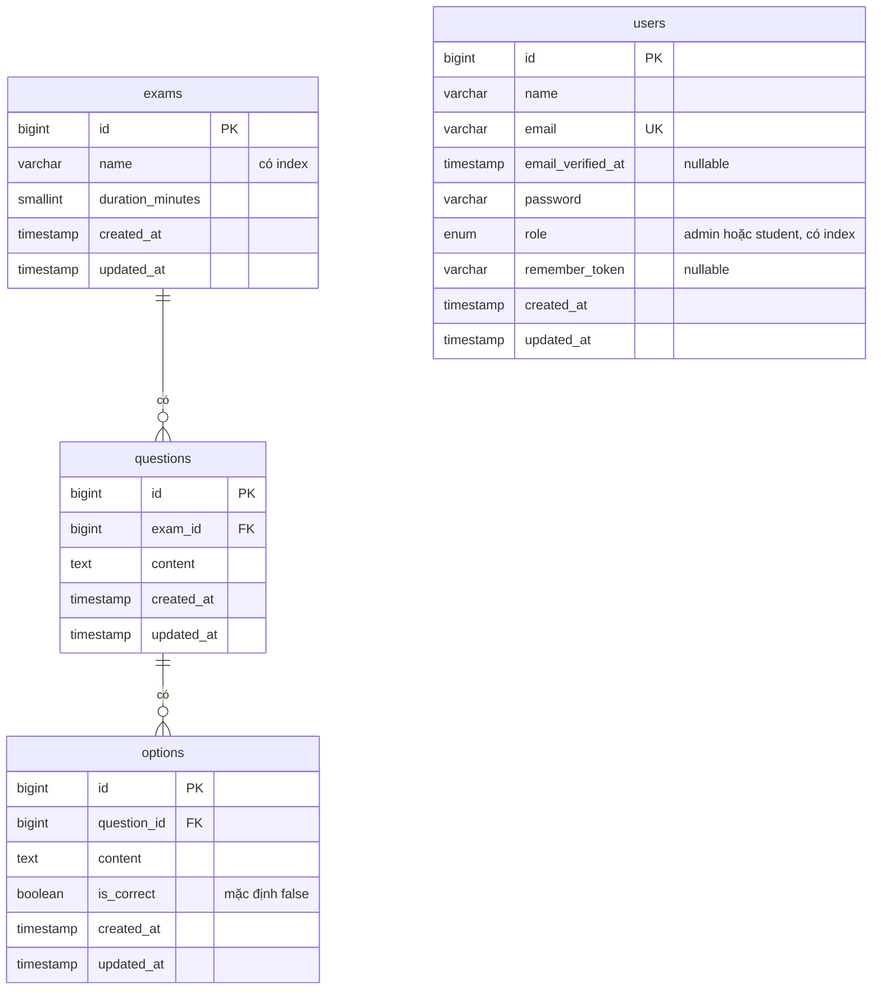

# Hệ thống thi trắc nghiệm

Bài test Laravel 11 dùng MySQL 8 và MongoDB 7, chạy bằng Docker.

**Trạng thái hiện tại:** mới xong phần lớn phần setup, chưa có tính năng nghiệp vụ. Chi tiết ở mục [Những gì chưa làm được và vì sao](#những-gì-chưa-làm-được-và-vì-sao).

## Chạy dự án

Chỉ cần Docker Desktop (hoặc Docker Engine có Compose v2) và các cổng `8000`, `3306`, `27018` đang trống. Không cần cài PHP, Composer, MySQL hay MongoDB trên máy.

```bash
git clone https://github.com/TQanh23/test_intern.git
cd test_intern
docker compose up -d
```

Mở <http://localhost:8000>. Lần đầu sẽ lâu hơn vì phải tải image và dependency, lệnh `up -d` chỉ xong khi app đã sẵn sàng.

Mỗi lần khởi động, container `app` tự chạy [docker/php/entrypoint.sh](docker/php/entrypoint.sh): tạo `.env` nếu chưa có, chạy `composer install`, tạo `APP_KEY` nếu còn trống, rồi chạy migration. Seed chỉ chạy khi database còn trống.

Sau khi sửa `docker/php/`, chạy `docker compose up -d --build` để build lại image.

Nếu trùng cổng, sửa phần `ports` trong `docker-compose.yml`. App không bị ảnh hưởng vì các container gọi nhau qua cổng nội bộ.

## Lệnh thường dùng

| Việc cần làm | Lệnh |
|---|---|
| Chạy test | `docker compose exec app php artisan test` |
| Chạy lệnh artisan | `docker compose exec app php artisan <lệnh>` |
| Cài package PHP | `docker compose exec app composer require <package>` |
| Chạy Vite (cần Node trên máy) | `npm install && npm run dev` |
| Tắt stack, giữ dữ liệu | `docker compose down` |
| Tắt stack, xóa cả dữ liệu | `docker compose down -v` |

Kết nối từ công cụ trên máy:

| Dịch vụ | Địa chỉ | Tài khoản |
|---|---|---|
| MySQL | `127.0.0.1:3306`, database `exam` | `exam` / `secret` |
| MongoDB | `mongodb://127.0.0.1:27018`, database `exam` | không có |

Các thông tin trên chỉ dùng cho môi trường dev.

## Quyết định kỹ thuật

### Dữ liệu nào để MySQL, dữ liệu nào để MongoDB

Schema MySQL đã có migration. Phần MongoDB mới là thiết kế, chưa được code.

| Nơi lưu | Dữ liệu | Lý do |
|---|---|---|
| MySQL | `users`, `exams`, `questions`, `options` | Dữ liệu có quan hệ chặt, được admin sửa thường xuyên, cần foreign key và ràng buộc unique. |
| MongoDB | `attempts` | Mỗi lượt làm bài là một document chứa snapshot câu hỏi, câu trả lời và điểm. Đọc kết quả không cần join. |
| MongoDB | `activity_logs` | Dữ liệu chỉ ghi thêm, số lượng lớn, mỗi hành động có thể có trường khác nhau. |

- **Vì sao `attempts` cần snapshot:** nếu admin sửa hoặc xóa câu hỏi sau khi thi, bài đã nộp vẫn phải giữ nguyên nội dung và điểm.
- **Thống kê:** điểm trung bình, top học sinh và câu sai nhiều đều nằm trong `attempts`, nên dùng aggregation của MongoDB.
- **Đánh đổi:** MongoDB không có foreign key tới MySQL. `user_id` và `exam_id` trong `attempts` phải do code ứng dụng giữ đúng.

### ERD MySQL



- **Xóa theo:** xóa một đề sẽ xóa các câu hỏi của đề đó, xóa một câu hỏi sẽ xóa các đáp án của câu đó (`ON DELETE CASCADE`).
- **`users` đứng riêng:** không có khóa ngoại tới bảng đề thi, vì lượt làm bài nối học sinh với đề nằm ở `attempts` trong MongoDB.
- **Không vẽ các bảng hạ tầng của Laravel:** `password_reset_tokens`, `sessions`, `cache`, `cache_locks`, `jobs`, `job_batches`, `failed_jobs`.

### Môi trường Docker

- **PHP và Composer nằm trong container:** tránh phải cài extension `mongodb` trên từng máy.
- **Entrypoint tự chuẩn bị app:** chỉ cần `docker compose up`. Nginx chờ healthcheck của `app` nên không trả lỗi 502 trong lúc cài dependency.
- **`vendor` nằm trong named volume, không bind mount:** trên Windows, bind mount khiến mỗi lệnh `artisan` mất khoảng 14 giây, dùng volume còn khoảng 0,4 giây. Đổi lại, `vendor` trên máy không tự cập nhật, nên IDE có thể chưa gợi ý code của package mới.
- **MongoDB mở ra máy qua cổng `27018`:** tránh trùng với MongoDB cài sẵn trên máy, thường chiếm `27017`.
- **MySQL và MongoDB chỉ bind vào `127.0.0.1`:** MongoDB không đặt mật khẩu nên không được mở ra mạng ngoài.

### Giữ Laravel 11 dù có cảnh báo bảo mật

Đề yêu cầu Laravel 11, nhưng nhánh 11.x không còn được vá nên Composer chặn cài đặt. Dự án khóa ở `^11.57` và chỉ bỏ qua đúng 5 mã cảnh báo trong `composer.json`, không tắt cơ chế chặn.

| Mã | Mức độ | Vấn đề | Cách xử lý trong dự án |
|---|---|---|---|
| `PKSA-b41t-wbzk-9q51` | Critical | Bypass xác thực ở `TokenGuard` | Không dùng auth driver `token`. |
| `PKSA-3r5d-mb8f-1qw9` | High | CRLF injection ở rule email mặc định | Dự án chạy local, mail chỉ ghi log. |
| `PKSA-mdq4-51ck-6kdq` | Chưa phân loại | Cùng lỗi CRLF ở trên | Như trên. |
| `PKSA-m5cs-t1y6-qpcs` | Medium | Nhầm đường dẫn ở Temporary Signed URL | Phải kiểm tra lại trước khi làm task 21. |
| `PKSA-d5tc-s1qs-h781` | Low | XSS ở trang debug | Chỉ bật `APP_DEBUG` ở local. |

Khi triển khai thật cần nâng lên Laravel 12.69+ hoặc 13.30+.

## Những gì chưa làm được và vì sao

Lý do chung: bài đang được làm theo thứ tự, phần setup làm trước nên các task sau chưa bắt đầu.

| Task | Nội dung | Trạng thái | Còn thiếu |
|---|---|---|---|
| 1 | Khởi tạo Laravel 11 | Xong | |
| 2 | Docker hóa | Xong | |
| 3 | Kết nối MySQL | Một phần | Đã có kết nối và migration mặc định. Chưa có seeder admin, student, đề thi mẫu. |
| 4 | Kết nối MongoDB | Một phần | Đã có package và connection. Chưa có Model Mongo. |
| 5 | `app:check-connections` | Chưa làm | |
| 6 | README | Xong | Cần cập nhật khi các task sau hoàn thành. |
| 7 | Schema MySQL | Xong | |
| 8 | Collection MongoDB | Chưa làm | Mới có thiết kế ở trên. |
| 9–14 | Tính năng chính | Chưa làm | |
| 15–17 | Activity log, API, tổ chức code | Chưa làm | |
| 18 | Feature test | Chưa làm | Mới có test mẫu của Laravel và test schema. Chưa có test chấm điểm, nộp quá giờ. |
| 19 | Bonus | Chưa làm | |
| 20–22 | Nâng cao | Chưa làm | Task 21 cần thêm `ffmpeg` vào image để cắt audio. |

Các hạn chế khác:

- **Seed không tự chạy lại:** seeder hiện là mặc định của Laravel, chạy lại trên database đã có dữ liệu sẽ lỗi trùng email. Dùng `php artisan migrate:fresh --seed` để làm lại từ đầu.
- **Test chạy bằng SQLite in-memory:** nhờ vậy test không đụng database dev, nhưng không phát hiện được lỗi riêng của MySQL.
- **Chưa thử trên Linux và macOS:** các lệnh trên mới được chạy thử trên Windows 11 với Docker Desktop.
- **Các commit khung Laravel không phải code tự viết:** chúng được chia nhỏ từ code do `composer create-project` sinh ra.
